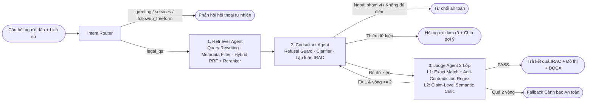

# APCR-RAG — Administrative & Penal Criminal RAG

> **Hệ thống Multi-Agent RAG Tư vấn Thủ tục Hành chính Công và Tố tụng Hình sự**  
> **Học phần:** INT 3507 2 — Các vấn đề hiện đại của Công nghệ Thông tin  
> **Giảng viên hướng dẫn:** TS. Nghiêm Nguyễn Việt Dũng  
> **Nhóm 9:** Phạm Đức Trọng · Vũ Gia Anh Đức · Nguyễn Hữu Hải Long

---

## 1. Tổng quan & Giá trị cốt lõi

**APCR-RAG** giải quyết 4 điểm nghẽn kinh điển của Single-Agent RAG truyền thống trong bài toán pháp lý (ảo giác mức lệ phí/thời hạn, đứt gãy thành phần hồ sơ do fixed-size chunking, nhầm lẫn cấp thẩm quyền và thiếu cơ chế tự kiểm chứng) bằng:

1. **Lược đồ Hồ sơ 6 Trường JSON Chuẩn hóa (`ProcedureRecord`)** kết hợp **Siêu dữ liệu Thời gian (Temporal Metadata)** (`ĐANG HIỆU LỰC` / `HẾT HIỆU LỰC`, `ngay_hieu_luc`, `van_ban_thay_the`) trên **40 thủ tục** (`28` Thủ tục hành chính, `12` Tố tụng hình sự; trong đó `38` đang hiệu lực, `2` hết hiệu lực).
2. **Kiến trúc Đa tác tử (Multi-Agent RAG)** điều phối trên **LangGraph `StateGraph`** kèm **Intent Router** (`greeting`, `services`, `followup_freeform`, `legal_qa`), chế độ **Streaming tiến trình từng Agent** và **Hội thoại đa lượt (`chat_history`)**:
   - **Agent 1 — Retriever Agent (`src/retriever/`):** Tách từ tiếng Việt (`pyvi`), viết lại câu hỏi & định tuyến miền (Hành chính vs Tố tụng Hình sự), lọc metadata thời gian, Hybrid Search (`Rank-BM25 + ChromaDB Vector Store`) kết hợp **RRF có trọng số** (`BM25_WEIGHT` / `VECTOR_WEIGHT`) và **Reranker (`LightweightLegalReranker` / `BAAI/bge-reranker-v2-m3`)**.
   - **Agent 2 — Consultant Agent (`src/consultant/`):** Hàng rào từ chối chủ động (`Deterministic Refusal`), hỏi ngược làm rõ (`Clarifier`), lập luận 4 bước chuẩn **IRAC** (*Issue – Rule – Application – Conclusion*), tự hiệu chỉnh (`Self-Revision Loop`, tối đa 2 vòng), đồ thị liên thủ tục `NetworkX` và xuất biểu mẫu `.docx` điền sẵn (`ProcedureFormGenerator`).
   - **Agent 3 — Judge / Critic Agent (`src/judge/` — 2 Lớp nâng cấp):**
     - **Lớp 1 (Deterministic Code + Anti-Contradiction Regex):** Đối soát tuyệt đối mã thủ tục, điều luật, biểu mẫu, lệ phí, thời hạn trên cả `CitationMetadata` **lẫn bóc tách Regex trực tiếp từ phần văn xuôi IRAC** để chặn mâu thuẫn giữa metadata và nội dung tư vấn.
     - **Lớp 2 (General Claim-Level Semantic Critic):** Tách `dieu_kien_bat_buoc` thành các mệnh đề nguyên tử (atomic claims), đối soát độ phủ mệnh đề, cực tính mệnh đề cấm/miễn phí/hết hiệu lực, phân cấp thẩm quyền và giai đoạn tố tụng trên mọi thủ tục.
3. **Pipeline Tự động hóa Nguồn Chính thống (`src/ingestion/`):**
   - Thu thập công khai từ **Cổng Văn bản Chính phủ** (`vanban.chinhphu.vn` + PDF ký số `datafiles.chinhphu.vn`) và **Công báo Chính phủ** (`congbao.chinhphu.vn`) qua cả giao diện Web và CLI (`src/ingestion/sync_cli.py`).
   - Trích xuất PDF qua `pypdf` kèm fallback OCR cho PDF scan bằng **Gemini Multimodal**, phát hiện văn bản mới thay thế/bãi bỏ quy định cũ (`UPDATE_EXPIRY`), kiểm duyệt qua **Staging Queue** có sao lưu tự động và làm mới nóng `RetrieverAgent`.
4. **Giao diện Web Chatbot (Streamlit — Tông Đỏ & Trắng, 4 Phân hệ):**
   - **Trò chuyện Pháp lý:** Hội thoại tự nhiên có thanh lịch sử trò chuyện lưu bền vững (`data/.apcr_chat_sessions.json`), chip chọn nhanh khi `Clarifier` hỏi ngược làm rõ, ngăn chi tiết IRAC / Judge / Đồ thị liên thông `NetworkX` (`streamlit-agraph`) và hộp thoại điền xuất đơn `.docx` ngay trong chat.
   - **Tra cứu Văn bản (BM25):** Tìm kiếm tức thì Zero-LLM kèm tô sáng từ khóa và tạo biểu mẫu `.docx`.
   - **Cảnh báo & Benchmark:** 10 Cảnh báo Hiểu nhầm Pháp lý phổ biến và Dashboard thực nghiệm Benchmark mở rộng **300 câu chuẩn luật** (kèm tùy chọn chạy nhanh bộ lõi 50 câu) / Ablation Study.
   - **Đồng bộ Nguồn Chính thống:** Gồm 3 tab (*Thu thập từ Cổng Chính phủ*, *Nạp từ URL / Tải tệp PDF*, *Hàng đợi Kiểm duyệt Staging*).

---

## 2. Sơ đồ Kiến trúc Multi-Agent



---

## 3. Cấu trúc Mã nguồn (Clean & Modular Architecture)

```text
├── .streamlit/
│   └── config.toml               # Cấu hình theme Đỏ - Trắng cho Streamlit
├── app_streamlit.py              # Giao diện Chatbot 4 phân hệ (Chat, BM25, Cảnh báo & Benchmark, Đồng bộ)
├── data/
│   ├── data_procedures.json        # 40 thủ tục chuẩn hóa 6 trường (28 Hành chính, 12 Hình sự; 38 hiệu lực, 2 hết hiệu lực)
│   ├── benchmark_300_questions.json # 300 câu hỏi kiểm thử chuẩn luật phủ 100% 40 thủ tục (150 Hành chính, 150 Hình sự)
│   ├── benchmark_50_questions.json  # Tập con 50 câu kiểm thử nhanh (25 Hành chính, 25 Hình sự)
│   └── chroma_db/                  # Vector store bền vững (ChromaDB)
├── src/
│   ├── core/                     # Cấu hình trung tâm (config.py) & LLM Factory (Gemini + Ollama + Fallback)
│   ├── schemas/                  # Pydantic Schemas (ProcedureRecord, IRACOutput, JudgeVerificationResult, Benchmark)
│   ├── retriever/                # [Nguyễn Hữu Hải Long] Tokenizer (pyvi), Query Rewriter, Filter, BM25, Vector, RRF, Reranker
│   ├── consultant/               # [Vũ Gia Anh Đức] Prompts, Refusal, Clarifier, Conversational Advisor, IRAC, Graph (NetworkX), Form DOCX
│   ├── baseline/                 # [Vũ Gia Anh Đức] Fixed-size Chunker & Single-Agent Baseline đối chứng
│   ├── judge/                    # [Phạm Đức Trọng] Layer 1 Regex Cross-check, Layer 2 Claim-level Critic, 10 Misconceptions
│   ├── workflow/                 # [Phạm Đức Trọng] Intent Router, LangGraph StateGraph, Edges, Streaming Orchestrator
│   ├── evaluation/               # [Phạm Đức Trọng] Benchmark 300 câu chuẩn luật, Ablation Study 4 cấu hình, Confusion Matrix, RAGAS
│   ├── ingestion/                # Pipeline thu thập nguồn chính thống (vanban/congbao.chinhphu.vn), PDF/OCR, Staging, sync_cli.py
│   └── *_agent.py / langgraph_workflow.py / schema.py # Lớp facade tương thích ngược cho các module trong src/
├── tests/                        # 49 unit test tự động (Judge, Consultant, Clarifier, Chatbot, Ingestion, Reranker, Workflow & 300-Q Audit)
├── requirements.txt
└── .env.example
```

---

## 4. Hướng dẫn Cài đặt & Chạy Hệ thống

### 4.1. Cài đặt môi trường
```bash
python -m venv .venv
# Windows PowerShell:
.venv\Scripts\Activate.ps1
pip install -r requirements.txt
```

### 4.2. Cấu hình biến môi trường (`.env`)
Sao chép `.env.example` thành `.env` và tùy chỉnh theo chế độ mong muốn:

- **Chế độ Google Gemini (mặc định `LLM_PROVIDER=auto`):** Điền `GOOGLE_API_KEY` (Google AI Studio) và `GEMINI_MODEL=gemini-3.5-flash-lite`. Nếu bỏ trống API key, hệ thống tự động vận hành ở chế độ **Deterministic Fallback Offline** mượt mà để demo không cần mạng.
- **Chế độ Local LLM qua Ollama (`LLM_PROVIDER=ollama` hoặc `OLLAMA_ENABLED=true`):** Cấu hình `OLLAMA_BASE_URL=http://localhost:11434` và `OLLAMA_MODEL=qwen2.5:7b` (hoặc `vistral`).
- **Chế độ Tất định hoàn toàn (`LLM_PROVIDER=none`):** Ép tắt LLM ngoài để tái lập benchmark tất định hoặc chạy offline tốc độ cao.
- **Tùy chọn Embedding & Reranker nặng:** Mặc định `USE_LIGHTWEIGHT_EMBEDDING=true` và `USE_CROSS_ENCODER_RERANKER=false` để khởi động nhanh; có thể chuyển sang `BAAI/bge-m3` và `BAAI/bge-reranker-v2-m3` khi có GPU/tài nguyên phù hợp.

### 4.3. Khởi chạy Giao diện Web & CLI Đồng bộ Nguồn
```bash
# 1. Khởi chạy giao diện Streamlit (http://localhost:8501)
streamlit run app_streamlit.py

# 2. (Tùy chọn) Đồng bộ văn bản từ Cổng Chính phủ vào Staging Queue qua CLI
python -m src.ingestion.sync_cli --keyword "thủ tục hành chính" --limit 3
# Thêm --no-llm nếu muốn chạy bóc tách Regex ngoại tuyến
```

### 4.4. Chạy Kiểm thử Tự động & Thực nghiệm Benchmark
```bash
# Chạy bộ kiểm thử tự động (49 unit test, bao gồm kiểm định chéo 300 câu hỏi với kho luật)
python -m unittest discover -s tests -v

# Chạy toàn bộ Benchmark 300 câu + Ablation Study 4 cấu hình ở chế độ tất định tái lập được:
# Windows PowerShell:
$env:LLM_PROVIDER="none"; python -c "import json; from src.evaluation import run_full_benchmark_evaluation; print(json.dumps(run_full_benchmark_evaluation(), indent=2, ensure_ascii=False))"

# Linux / macOS (bash):
LLM_PROVIDER=none python -c "import json; from src.evaluation import run_full_benchmark_evaluation; print(json.dumps(run_full_benchmark_evaluation(), indent=2, ensure_ascii=False))"
```

*(Lưu ý: Nếu chạy `run_full_benchmark_evaluation()` khi `.env` có `GOOGLE_API_KEY` hợp lệ và không đặt `LLM_PROVIDER=none`, hệ thống sẽ gọi trực tiếp Gemini API thật; có thể truyền `benchmark_path="data/benchmark_50_questions.json"` nếu muốn chạy nhanh tập 50 câu đại diện.)*

---

## 5. Kết quả Thực nghiệm Định lượng (Benchmark 300 câu & Ablation Study)

### 5.1. Đánh giá Mở rộng Toàn diện trên Bộ 300 câu chuẩn luật (`data/benchmark_300_questions.json`) & Live Gemini (`gemini-3.5-flash-lite`)
- **Quy mô & Độ phủ bộ 300 câu:** Gồm **150 câu Thủ tục hành chính + 150 câu Tố tụng hình sự** (`102` Tra cứu đơn · `106` Tình huống nhiều điều kiện · `92` Câu hỏi gài bẫy), phủ **100% toàn bộ 38 thủ tục đang hiệu lực + 2 quy định hết hiệu lực** đối soát tự động 1-1 với văn bản quy phạm pháp luật.
- **APCR-RAG trên Bộ 300 câu:** `Precision@1 = 100.0% (300/300)`, `Recall@3 = 100.0% (300/300)`, `Faithfulness = 100.0%`, `Hallucination Rate = 0.0%`, `Claim Coverage = 100.0%`.
- **Đánh giá trên LLM thật (`gemini-3.5-flash-lite`, tập kiểm định Live 50 câu đại diện):** Đạt `Precision@1 = 100.0%`, `Faithfulness = 100.0%`, `Hallucination Rate = 0.0%` (độ trễ TB `5861.9 ms`); trong bài **Self-Revision Stress Test** gài lỗi vòng 1, Judge bắt lỗi **100.0% (50/50)** và LLM thật tự sửa thành công **94.0% (47/50)** (`Fallback Warning` chặn an toàn 3 ca còn lại).

### 5.2. Ablation Study 4 cấu hình trên Bộ 300 câu (Chế độ tất định `LLM_PROVIDER=none`)

| Cấu hình hệ thống | Precision@1 | Recall@3 | Faithfulness (Phí + Hạn) | Hallucination Rate | Claim Coverage | Latency TB (ms) |
| :--- | :---: | :---: | :---: | :---: | :---: | :---: |
| 1. Single-Agent Baseline (Fixed Chunking) | 13.33% | 13.33% | 36.67% | 63.33% | 23.84% | 2.31 |
| 2. BM25-Only (Không Rewriter, Không Judge) | 98.67% | 100.0% | 98.67% | 1.33% | 98.67% | 13.57 |
| 3. Hybrid + IRAC (Không có Judge 2 Lớp) | 100.0% | 100.0% | 69.33% | 30.67% | 62.40% | 23.13 |
| **4. Full APCR-RAG (Hybrid + RRF + Reranker + IRAC + Judge 2 Lớp)** | **100.0%** | **100.0%** | **100.0%** | **0.0%** | **100.0%** | **26.33** |

- **Self-Revision Stress Test 300 ca (`LLM_PROVIDER=none`):** Bắt lỗi vòng 1 **300/300 (100.0%)**, tự sửa thành công **300/300 (100.0%)** (độ trễ TB `26.10 ms`).
- **Domain Routing Confusion Matrix (300 câu):** Định tuyến chính xác **150/150** Thủ tục hành chính và **150/150** Tố tụng hình sự (**Accuracy = 100.0%, F1 = 100.0%**).
- **Bộ kiểm thử tự động (`python -m unittest discover -s tests -v`):** **49/49 tests passed (`OK`)**.

---

## 6. Mở rộng Tích hợp Chatbot đa kênh (Zalo OA / Telegram / API)

Toàn bộ lõi Multi-Agent của APCR-RAG được tách độc lập khỏi Streamlit, có thể bọc thành REST API hoặc Bot trên **Zalo OA / Telegram / Messenger** thông qua các điểm vào chính:

- `run_legal_multi_agent_workflow(query=..., chat_history=...)` hoặc `stream_legal_multi_agent_workflow(...)` trong `src/workflow/orchestrator.py`: nhận tin nhắn và lịch sử hội thoại theo `user_id`, trả về `LegalWorkflowState` (gồm `needs_clarification`, `clarification_candidates`, `irac_draft.direct_advice`, `primary_procedure`, `final_status`).
- `generate_procedure_docx_bytes(primary_procedure, user_data=...)` trong `src/consultant/form_generator.py`: tạo trực tiếp file `.docx` dạng bytes để gửi tệp đính kèm qua API của nền tảng nhắn tin.

---

## 7. Ảnh minh họa Giao diện Hệ thống


