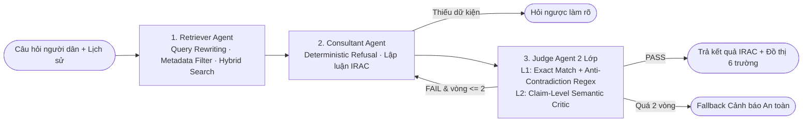

# APCR-RAG — Administrative & Penal Criminal RAG

> **Hệ thống Multi-Agent RAG Tư vấn Thủ tục Hành chính Công và Tố tụng Hình sự**  
> **Học phần:** INT 3507 2 — Các vấn đề hiện đại của Công nghệ Thông tin  
> **Giảng viên hướng dẫn:** TS. Nghiêm Nguyễn Việt Dũng  
> **Nhóm 9:** Phạm Đức Trọng · Vũ Gia Anh Đức · Nguyễn Hữu Hải Long

---

## 1. Tổng quan & Giá trị cốt lõi

**APCR-RAG** giải quyết 4 điểm nghẽn kinh điển của Single-Agent RAG truyền thống trong bài toán pháp lý (ảo giác mức lệ phí/thời hạn, đứt gãy thành phần hồ sơ do fixed-size chunking, nhầm lẫn cấp thẩm quyền và thiếu cơ chế tự kiểm chứng) bằng:

1. **Lược đồ Hồ sơ 6 Trường JSON Chuẩn hóa (`ProcedureRecord`)** kết hợp **Siêu dữ liệu Thời gian (Temporal Metadata)** (`ĐANG HIỆU LỰC` / `HẾT HIỆU LỰC`, `ngay_hieu_luc`, `van_ban_thay_the`) trên **40 thủ tục** (`38` đang hiệu lực, `2` hết hiệu lực).
2. **Kiến trúc Đa tác tử (Multi-Agent RAG)** điều phối trên **LangGraph `StateGraph`** kèm **Intent Router**, chế độ **Streaming tiến trình từng Agent** và **Hội thoại đa lượt (`chat_history`)**:
   - **Agent 1 — Retriever Agent (`src/retriever/`):** Tách từ tiếng Việt (`pyvi`), viết lại câu hỏi & định tuyến miền (Hành chính vs Tố tụng Hình sự), lọc metadata thời gian, Hybrid Search (`Rank-BM25 + ChromaDB Vector Store`) kết hợp **RRF chuẩn hóa** và **Reranker (`LightweightLegalReranker` / `BAAI/bge-reranker-v2-m3`)**.
   - **Agent 2 — Consultant Agent (`src/consultant/`):** Hàng rào từ chối chủ động (`Deterministic Refusal`), hỏi ngược làm rõ (`Clarifier`), lập luận 4 bước chuẩn **IRAC** (*Issue – Rule – Application – Conclusion*), tự hiệu chỉnh (`Self-Revision Loop`), đồ thị liên thủ tục `NetworkX` và xuất biểu mẫu `.docx` (`FormGenerator`).
   - **Agent 3 — Judge / Critic Agent (2 Lớp nâng cấp — `src/judge/`):**
     - **Lớp 1 (Deterministic Code + Anti-Contradiction Regex):** Đối soát tuyệt đối mã thủ tục, điều luật, biểu mẫu, lệ phí, thời hạn trên cả `CitationMetadata` **lẫn bóc tách Regex trực tiếp từ phần văn xuôi IRAC** để chặn mâu thuẫn giữa metadata và nội dung tư vấn.
     - **Lớp 2 (General Claim-Level Semantic Critic):** Tách `dieu_kien_bat_buoc` thành các mệnh đề nguyên tử (atomic claims), đối soát độ phủ mệnh đề, cực tính mệnh đề cấm/miễn phí/hết hiệu lực, phân cấp thẩm quyền và giai đoạn tố tụng trên mọi thủ tục.
3. **Pipeline Tự động hóa Nguồn Chính thống (`src/ingestion/`):**
   - Thu thập công khai từ **Cổng Văn bản Chính phủ** (`vanban.chinhphu.vn` + PDF ký số `datafiles.chinhphu.vn`) và **Công báo Chính phủ** (`congbao.chinhphu.vn`).
   - Trích xuất PDF qua `pypdf` kèm fallback OCR cho PDF scan bằng **Gemini Multimodal**, phát hiện văn bản mới thay thế/bãi bỏ quy định cũ (`UPDATE_EXPIRY`), kiểm duyệt qua **Staging Queue** có sao lưu tự động và làm mới nóng `RetrieverAgent`.
4. **Giao diện Web Chatbot (Streamlit — Tông Đỏ nhạt & Trắng):**
   - Màn hình Chatbot hội thoại tự nhiên có thanh lịch sử trò chuyện bên trái, chip chọn nhanh khi `Clarifier` hỏi ngược làm rõ, ngăn chi tiết IRAC / Judge / Liên thông `NetworkX` và hộp thoại điền xuất đơn `.docx` ngay trong chat.
   - Tra cứu Văn bản & Thủ tục Tức thì (Zero-LLM BM25 + tạo đơn `.docx`), Cảnh báo Hiểu nhầm & Dashboard Benchmark 50 câu, và Phân hệ **Đồng bộ Nguồn Chính thống**.

---

## 2. Sơ đồ Kiến trúc Multi-Agent



---

## 3. Cấu trúc Mã nguồn (Clean & Modular Architecture)

```text
├── app_streamlit.py              # Giao diện Chatbot Đỏ nhạt-Trắng + 4 phân hệ (Chat, BM25, Benchmark, Đồng bộ)
├── data/
│   ├── data_procedures.json      # 40 thủ tục chuẩn hóa 6 trường (38 đang hiệu lực, 2 hết hiệu lực)
│   └── benchmark_50_questions.json # 50 câu hỏi kiểm thử (25 Hành chính, 25 Hình sự; 3 độ khó)
├── src/
│   ├── core/                     # Cấu hình trung tâm (config.py) & LLM Factory (Gemini + Ollama)
│   ├── schemas/                  # Pydantic Schemas (ProcedureRecord, IRACOutput, JudgeVerificationResult)
│   ├── retriever/                # [Nguyễn Hữu Hải Long] Tokenizer (pyvi), Query Rewriter, Filter, BM25, Vector, RRF, Reranker
│   ├── consultant/               # [Vũ Gia Anh Đức] Prompts, Refusal, Clarifier, IRAC, Graph (NetworkX), Form DOCX
│   ├── baseline/                 # [Vũ Gia Anh Đức] Fixed-size Chunker & Single-Agent Baseline đối chứng
│   ├── judge/                    # [Phạm Đức Trọng] Layer 1 Regex Cross-check, Layer 2 Claim-level Critic, Misconceptions
│   ├── workflow/                 # [Phạm Đức Trọng] Intent Router, LangGraph StateGraph, Edges, Streaming Orchestrator
│   ├── evaluation/               # [Phạm Đức Trọng] Benchmark 50 câu, Ablation Study 4 cấu hình, Confusion Matrix, RAGAS
│   └── ingestion/                # Pipeline thu thập nguồn chính thống (vanban/congbao.chinhphu.vn), PDF/OCR, Staging
├── tests/                        # 48 unit test tự động (Judge, Consultant, Clarifier, Ingestion, Reranker, Workflow)
├── requirements.txt
└── .env.example
```

---

## 4. Hướng dẫn Cài đặt & Chạy Hệ thống

### 4.1. Cài đặt môi trường
```bash
python -m venv .venv
# Windows PowerShell:
.venv\Scripts\Activate.ps1
pip install -r requirements.txt
```

### 4.2. Cấu hình biến môi trường (Tùy chọn LLM thật)
Sao chép `.env.example` thành `.env` và điền `GOOGLE_API_KEY` (Google AI Studio). Nếu để trống, hệ thống tự động vận hành ở chế độ **Deterministic Fallback Offline** mượt mà để demo không cần kết nối mạng.

### 4.3. Khởi chạy Giao diện Web
```bash
streamlit run app_streamlit.py
```
Truy cập trình duyệt tại `http://localhost:8501`.

### 4.4. Chạy Kiểm thử Tự động & Thực nghiệm Benchmark
```bash
# Chạy bộ kiểm thử tự động (Judge Lớp 1/2, Workflow Streaming, Self-Revision, Ablation)
python -m unittest discover -s tests -v

# Chạy toàn bộ Benchmark 50 câu + Ablation Study 4 cấu hình + Confusion Matrix
python -c "import json; from src.evaluation import run_full_benchmark_evaluation; print(json.dumps(run_full_benchmark_evaluation(), indent=2, ensure_ascii=False))"
```

---

## 5. Kết quả Thực nghiệm Định lượng (Benchmark 50 câu & Ablation Study)

### 5.1. Đánh giá Toàn trình trên LLM thật (`gemini-3.5-flash-lite`)
- **APCR-RAG End-to-End (50 câu):** `Precision@1 = 100.0%`, `Recall@3 = 100.0%`, `Faithfulness = 100.0%`, `Hallucination Rate = 0.0%`, `Claim Coverage = 100.0%`, độ trễ trung bình `5861.9 ms`.
- **Self-Revision Stress Test (50/50 câu gài lỗi vòng 1):** Tỷ lệ Judge bắt lỗi vòng 1 đạt **100.0% (50/50)**; tỷ lệ LLM tự sửa thành công đạt **94.0% (47/50)** (công cụ `Fallback Warning` tự động chặn 3 ca còn lại sau 2 vòng sửa, độ trễ TB `3533.68 ms`).

### 5.2. Ablation Study 4 cấu hình (Chế độ tất định tái lập được)

| Cấu hình hệ thống | Precision@1 | Recall@3 | Faithfulness (Phí + Hạn) | Hallucination Rate | Claim Coverage | Latency (ms) |
| :--- | :---: | :---: | :---: | :---: | :---: | :---: |
| 1. Single-Agent Baseline (Fixed Chunking) | 20.0% | 20.0% | 29.0% | 71.0% | 18.85% | 2.30–10.08 |
| 2. BM25-Only (Không Rewriter, Không Judge) | 94.0% | 100.0% | 94.0% | 6.0% | 94.0% | 10.95–36.71 |
| 3. Hybrid + IRAC (Không có Judge 2 Lớp) | 100.0% | 100.0% | 70.0% | 30.0% | 63.0% | 22.42–69.90 |
| **4. Full APCR-RAG (Hybrid + RRF + Reranker + IRAC + Judge 2 Lớp)** | **100.0%** | **100.0%** | **100.0%** | **0.0%** | **100.0%** | **25.01–76.06** |

- **Self-Revision Stress Test (chế độ `LLM_PROVIDER=none`):** Bắt lỗi vòng 1 **50/50 (100.0%)**, tự sửa thành công **50/50 (100.0%)** (`76.09 ms`).
- **Domain Routing Confusion Matrix:** Định tuyến chính xác **25/25** Thủ tục hành chính và **25/25** Tố tụng hình sự (**Accuracy = 100.0%, F1 = 100.0%**).
- **Bộ kiểm thử tự động (`python -m unittest discover -s tests -v`):** **48/48 tests passed (`OK`)**.

---

## 6. Ảnh minh họa Giao diện Hệ thống


